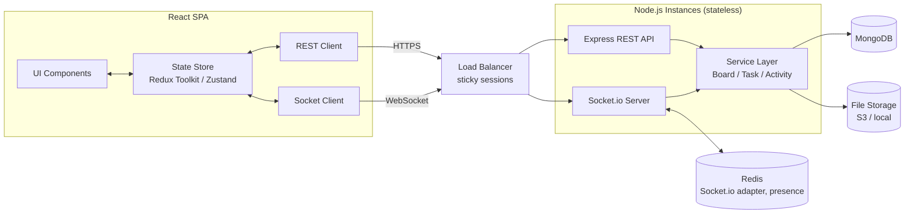
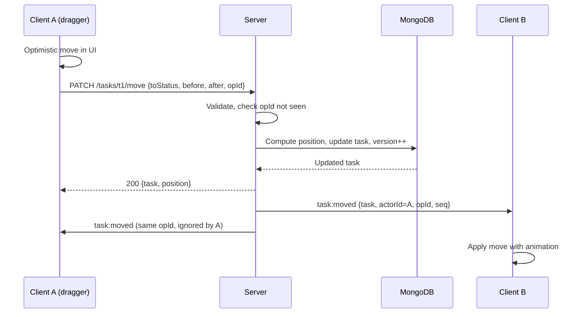
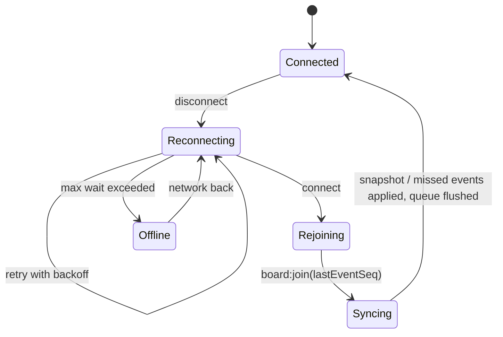

# System Architecture
## Real-Time Collaborative Task Board (MERN + Socket.io)

---

## 1. High-Level Architecture



**Core principle:** the server is the single source of truth. Every mutation is validated, persisted, then broadcast. Clients may update optimistically, but always reconcile with the server's result.

---

## 2. Technology Stack

| Layer | Choice | Reason |
|-------|--------|--------|
| Frontend | React 18, Vite | Fast dev, component model |
| State | Redux Toolkit (or Zustand) | Normalized state, predictable updates |
| Drag and drop | `@hello-pangea/dnd` or `dnd-kit` | Accessible, touch support |
| Styling | Tailwind CSS | Responsive utilities |
| Backend | Node.js, Express | MERN standard |
| Realtime | Socket.io | Mandatory; rooms, acks, auto-reconnect |
| Database | MongoDB + Mongoose | Flexible documents, easy indexing |
| Cache / pub-sub | Redis | Multi-instance Socket.io, presence |
| Auth | JWT (+ bcrypt) | Stateless, works for REST and sockets |
| Validation | Zod / Joi | Request schemas |
| Files (bonus) | Multer + S3/Cloudinary | Attachments |
| Testing | Jest, Supertest, Playwright, socket.io-client | Unit, API, E2E, realtime |

---

## 3. Backend Architecture

### 3.1 Folder Structure
```
server/
├── src/
│   ├── config/            # env, db, redis
│   ├── models/            # User, Board, Task, Activity, Attachment
│   ├── routes/            # auth, boards, tasks, attachments
│   ├── controllers/       # thin HTTP handlers
│   ├── services/          # business logic (taskService.move, ...)
│   ├── middleware/        # auth, validate, boardMember, rateLimit, error
│   ├── sockets/
│   │   ├── index.js       # io setup, auth handshake
│   │   ├── boardHandlers.js
│   │   ├── presence.js
│   │   └── emitters.js    # broadcast helpers
│   ├── utils/             # position calc, opId store, logger
│   └── app.js / server.js
└── tests/
```

### 3.2 Layering
`Route → Middleware → Controller → Service → Model`
After a service commits to the DB, it calls `emitters.broadcast(boardId, event, payload)`. Controllers never talk to sockets directly.

### 3.3 Database Indexes
| Collection | Index | Why |
|-----------|-------|-----|
| tasks | `{ boardId: 1, status: 1, position: 1 }` | Fetch and order columns |
| tasks | `{ boardId: 1, assignedTo: 1 }` | Member filter |
| tasks | `{ boardId: 1, dueDate: 1 }` | Date filter, analytics |
| boards | `{ "members.user": 1 }` | List my boards |
| activities | `{ boardId: 1, createdAt: -1 }` | Timeline |
| opLog (TTL 24h) | `{ opId: 1 }` unique | Idempotency |

---

## 4. Realtime Architecture

### 4.1 Rooms and Authentication
- Socket handshake verifies the JWT; `socket.data.userId` is set.
- `board:join` checks board membership, then `socket.join("board:<id>")`.
- Removed members are forced out with `io.in(room).socketsLeave` for that user's sockets.

### 4.2 Event Flow: Moving a Task



### 4.3 Presence
- Stored per board as a map `userId → Set<socketId>` (Redis hash/set when scaled).
- User is "online" while the set is non-empty, which handles multiple tabs.
- Emit `presence:update` on join, leave, and disconnect.

### 4.4 Typing Indicators
- Ephemeral: never stored in the DB.
- Relayed with `socket.to(room).emit(...)`; the server keeps a short-lived map with a 3 s TTL so stale indicators clear automatically.

### 4.5 Scaling
- `@socket.io/redis-adapter` so broadcasts reach sockets on any instance.
- Sticky sessions (or WebSocket-only transport) at the load balancer.

---

## 5. Synchronization Design

### 5.1 Ordering with Fractional Positions
Each task has a numeric `position` per column.
- Insert between neighbors: `position = (before.position + after.position) / 2`.
- Insert at top: `first.position / 2`. At bottom: `last.position + 1000`. Empty column: `1000`.
- If the gap becomes too small (below ~1e-6), **rebalance** the column (renumber 1000, 2000, ...) inside one transaction and broadcast a `board:snapshot` for that column.
- Ties are broken by `_id`, so order is always deterministic.

Why this works: moving one card updates **one document**, not every card in the column. Two simultaneous moves to different places never overwrite each other.

### 5.2 Concurrent Updates
| Scenario | Strategy |
|----------|----------|
| Different fields edited at once | Clients send **patches** (changed fields only); the server merges |
| Same field edited at once | Version check: stale `version` returns 409 with the latest task; the client shows a toast and offers keep mine / use theirs |
| Move vs. edit on the same task | Independent fields (`status/position` vs. content), so both apply |
| Move vs. delete | Delete wins; the move returns 404 and the client reverts |
| Two moves of the same task | Last write (server arrival order) wins; both clients converge on the broadcast result |

Atomic update example:
```js
Task.findOneAndUpdate(
  { _id, version },
  { $set: patch, $inc: { version: 1 } },
  { new: true }
);
```

### 5.3 Duplicate Suppression
- Every mutation includes a client `opId` (UUID).
- Server stores `opId → result` for 24 h; a replay returns the stored result and does not re-apply or re-broadcast.
- Client tracks its own pending `opId`s and ignores matching incoming events.

### 5.4 Event Sequencing and Gap Detection
- Per-board monotonically increasing `seq` (atomic `$inc` on the board document, or a Redis `INCR`).
- Every broadcast carries `seq`. If a client sees a jump, it requests a sync.

### 5.5 Disconnect and Reconnect



- While offline: show a banner, queue mutations (each with `opId`), and block drag if offline too long.
- After rejoin: server replies with missed events (if the gap is small) or a full `board:snapshot`. The client then replays the queued operations. Stale ones fail with 409 and surface a conflict toast.
- Auto-refresh also triggers on tab focus after long inactivity.

### 5.6 Invalid Position Handling
- Validate that `toStatus` is in the enum and that `before/after` tasks exist, belong to the same board and `toStatus`, and are in the correct order.
- If a neighbor was moved or deleted in the meantime, fall back to the nearest valid neighbor, or append at the end of the column.
- Reject non-numeric or negative values with 400.

---

## 6. Frontend Architecture

### 6.1 Folder Structure
```
client/src/
├── app/                # store, router
├── features/
│   ├── auth/
│   ├── boards/         # board list, create, invite
│   └── board/          # kanban: Column, TaskCard, TaskModal, FilterBar
├── services/           # api.js (axios), socket.js
├── hooks/              # useBoardSocket, useDebouncedTyping, useFilters
├── components/         # shared UI
└── utils/              # position helpers, opId
```

### 6.2 State Shape (normalized)
```js
{
  auth: { user, token },
  boards: { list: [...] },
  board: {
    meta: { id, title, createdBy },
    members: { byId, onlineIds },
    tasks: { byId: {...}, idsByStatus: { todo: [], in_progress: [], review: [], done: [] } },
    typing: { [taskId]: [{ userId, field }] },
    dragging: { [taskId]: userId },
    filters: { priority, memberId, dateRange },
    connection: 'connected' | 'reconnecting' | 'offline',
    lastEventSeq: 0,
    pendingOps: { [opId]: {...} }
  }
}
```
Filters are applied through selectors, so they never alter the underlying order.

### 6.3 Socket Integration
A single `useBoardSocket(boardId)` hook:
- connects with the JWT, joins the room, and registers handlers that dispatch store actions (`taskMoved`, `taskUpdated`, ...);
- cleans up on unmount;
- exposes emitters for typing and drag events.

### 6.4 Optimistic UI Pattern
1. Dispatch local change and record `pendingOps[opId]`.
2. Send the request.
3. On success: clear the pending op and adopt the server's task (position, version).
4. On failure: roll back from a stored snapshot and show a toast.

---

## 7. Security Architecture
- JWT verified in both Express middleware and Socket.io handshake middleware.
- Authorization check on every socket event (room membership and role).
- Zod validation on every payload (REST and socket).
- Rate limiting: REST via `express-rate-limit`; sockets via a per-socket token bucket.
- Helmet, strict CORS allow-list, parameterized queries through Mongoose, and sanitization of text fields.
- Upload validation (size, MIME) with files served via signed URLs.

---

## 8. Deployment

| Component | Option |
|-----------|--------|
| Frontend | Vercel / Netlify / S3 + CDN |
| Backend | Docker containers on Render / Railway / AWS ECS (2+ instances) |
| Database | MongoDB Atlas (replica set, required for transactions) |
| Redis | Upstash / ElastiCache |
| Observability | Winston/Pino logs, Sentry, metrics for socket count and event latency |
| CI/CD | GitHub Actions: lint, test, build, deploy |

---

## 9. Bonus Feature Architecture

**Activity timeline:** every service mutation writes an `Activity` document and emits `activity:new`. The REST endpoint is paginated by cursor.

**Analytics:** MongoDB aggregation pipelines over `tasks` (group by status, assignee, overdue, completed per day); cached for 60 s.

**Attachments:** Multer receives the upload, which is stored in S3 or on disk; metadata is saved in `Attachment` and `task:updated` is emitted so cards show a paperclip count.
